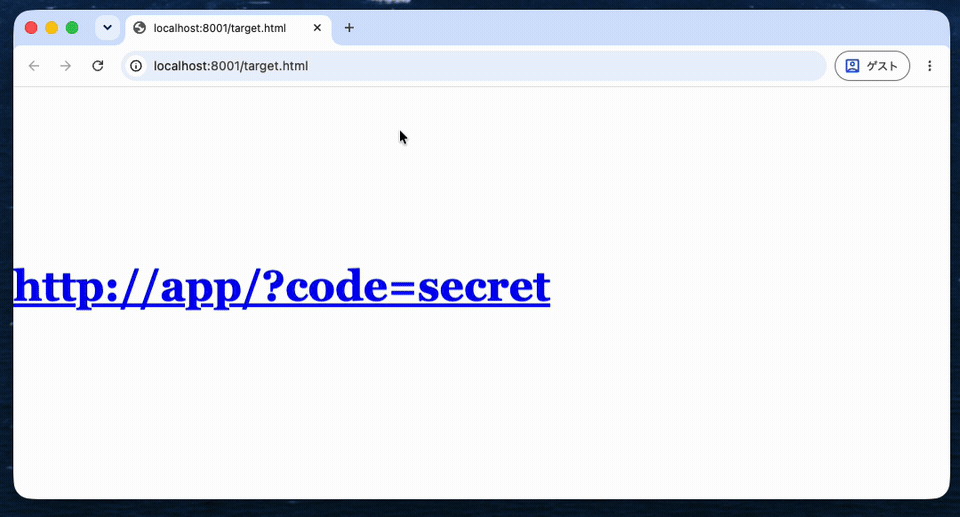
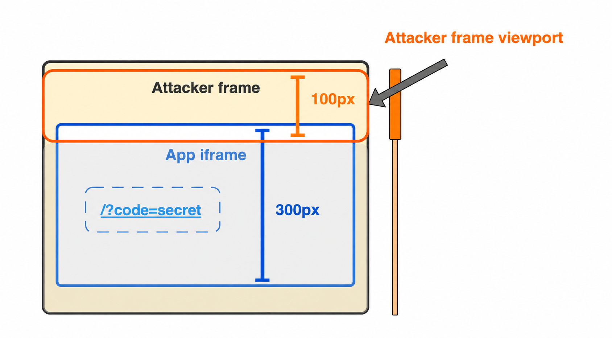
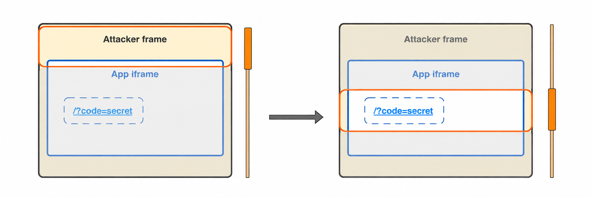
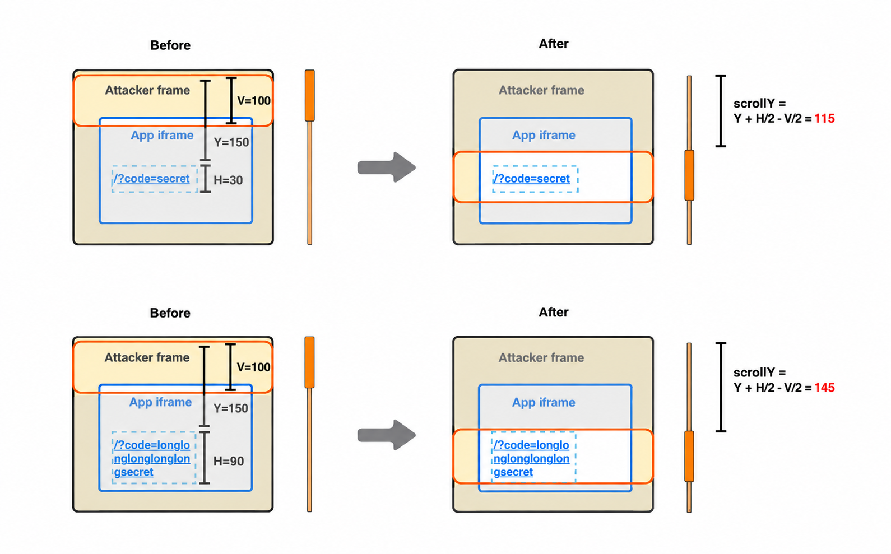
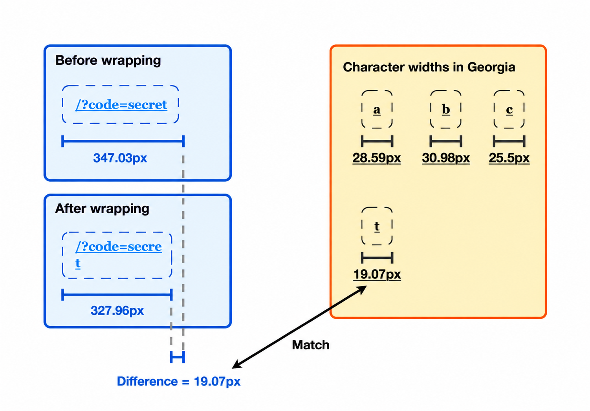

## Introduction

A few weeks ago, I created a challenge for IERAE CTF 2026 - FINAL for Humans Round 1. The challenge asked how to extract text embedded in an iframe when you can apply some CSS to it.

[https://github.com/tyage/dopa-secret](https://github.com/tyage/dopa-secret)

In this post, I describe an XS-Leaks technique that, to the best of my knowledge, is new. It measures the size of elements rendered inside a cross-origin iframe and, ultimately, recovers text rendered inside it, as shown below. This technique relies on behavior present in Google Chrome (version 156.0.8078.80) and may affect sites that can be embedded by other sites, under certain conditions. ([PoC](https://gist.github.com/tyage/87abb8a92bb4652eeb3f806eaa3d022e))

```html
<style>
  #secret {
    font: 700 48px/48px Georgia, serif;
    word-break: break-all;
  }
</style>
<a id="secret" href="http://app/?code=secret">http://app/?code=secret</a>
```



## 1. scroll-into-view crosses origin boundaries

### How scroll-into-view works

When an off-screen element on a web page receives focus, browsers such as Google Chrome scroll the page to bring it into view ([scroll-into-view](https://source.chromium.org/chromium/chromium/src/+/main:third_party/blink/renderer/core/scroll/scroll_into_view_util.cc;drc=3d627c11389dc4fe09c777f92377d0726dd79a2e)). A typical example is when the page scrolls to an off-screen form field or button as you move focus with the Tab key.

### Scroll propagation to the parent frame

Consider a scenario in which an attacker-controlled parent frame (Attacker frame) embeds a cross-origin site (App iframe).

Attacker frame (parent frame):

```html
<div style="height: 100px;"></div>
<iframe src="http://app/" height="300px"></iframe>
```

App iframe ( `http://app/` ):

```html
<div style="height: 100px;"></div>
<a id="secret" href="http://app/?code=secret">http://app/?code=secret</a>
```

Suppose the Attacker frame's window is only `100px` tall, while the App iframe is `300px` tall. The iframe is tall enough to render the link (`<a id="secret">`), but the parent frame shows only its top portion, so the link sits outside the viewport.



*The link inside the App iframe is not visible*

Now, if the iframe is loaded with a fragment URL such as `http://app/#secret`, the following happens:

1. The link with `id="secret"` receives focus.
2. To bring the element into view, Google Chrome [automatically scrolls the parent frame (Attacker frame)](https://source.chromium.org/chromium/chromium/src/+/main:third_party/blink/renderer/core/scroll/scroll_into_view_util.cc;l=296;drc=3d627c11389dc4fe09c777f92377d0726dd79a2e).



*The Attacker frame scrolls*

Crucially, **scroll-into-view propagates across origins to the parent frame**. By reading its own scroll position, the parent frame can tell where the focused element inside the child iframe is located.

## 2. Measuring element height and width from scroll offsets

In Chrome, the final scroll position depends not only on an element's coordinates but also on **its height and width**. This lets a cross-origin page infer the size of the target element.

### A simplified model

- Height of the parent frame's window: *V*
- Scroll offset of the parent frame: *scrollY*
- Top edge of the target element inside the child iframe, relative to the top of the parent frame: *Y*
- Height of the target element: *H*

Assume the parent frame starts at *scrollY* = 0 and the iframe is tall enough.

Depending on where the element sits before scrolling, the final *scrollY* is roughly as follows:

| Case | Condition | Scroll behavior | Final *scrollY* |
| --- | --- | --- | --- |
| **Element is already visible** | *Y* + *H* ≤ *V* | No scroll | *scrollY* = 0 |
| **Partially visible (too tall to fit)** | *Y* < *V* < *Y* + *H* and *V* ≤ *H* | Aligns the element's top edge with the top of the viewport | *scrollY* = *Y* |
| **Partially visible (fits on screen)** | *Y* < *V* < *Y* + *H* and *V* > *H* | Aligns the element's bottom edge with the bottom of the viewport | *scrollY* = *Y* + *H* − *V* |
| **Element is off-screen** | *V* ≤ *Y* | Centers the element in the viewport | *scrollY* = *Y* + (*H* − *V*) / 2 |



*When the element is off-screen, the scroll offset depends on the height of the focused element*

### Recovering height and width

If the element's *Y* is known, you can make *V* small enough to fall into the "Element is off-screen" case (where the element is centered in the viewport), and then solve for *H*:

*H* = 2 × *scrollY* − 2 × *Y* + *V*

Even if *Y* is unknown, *H* can still be estimated by varying *V* step by step and observing how *scrollY* changes.

The same approach works horizontally: observing *scrollX* reveals the element's width.

Since *scrollX* is rounded to an integer, it cannot directly capture sub-pixel widths. However, the parent frame can improve precision by scaling up the iframe's parent element with `transform: scaleX(128);`.

## 3. Narrowing down text candidates from element width

Once element sizes can be measured, it is possible under certain conditions to **infer the text itself**.

For example, suppose the following styles are applied to a link inside the App iframe:

```html
<style>
  #secret {
    font: 700 48px/48px Georgia, serif;
    word-break: break-all;
  }
</style>
<a id="secret" href="/?code=secret">/?code=secret</a>
```

This CSS has two important properties:

1. **`font: ... Georgia`**: each character (such as `a`–`z`) has a different width.
2. **`word-break: break-all`**: lines can break between any two characters (with a few exceptions).

If the parent frame gradually narrows the iframe, at some point the last character of the `<a>` element wraps to the next line, changing the element's width.

Because character widths vary in Georgia, **the change in width before and after the wrap identifies the character that wrapped**.



*Identifying the wrapped character "t" from the change in width (conceptual illustration)*

By repeatedly narrowing the iframe to force a wrap and measuring the resulting width, an attacker can recover candidates for the whole string, one character at a time. (In practice, kerning between character pairs and browser rounding errors need to be corrected for, but the principle holds.)

## Differences from prior work (2010)

Observing the parent frame's scroll position is not a new idea: it was [presented at Black Hat](https://media.blackhat.com/bh-eu-10/presentations/Stone/BlackHat-EU-2010-Stone-Next-Generation-Clickjacking-slides.pdf) in 2010 and reported as [Mozilla Bug 583889](https://bugzilla.mozilla.org/show_bug.cgi?id=583889). Scroll propagation in Google Chrome has also been publicly tracked as [Issue 40849420](https://issues.chromium.org/issues/40849420) since around 2022.

However, those earlier reports focused on **a boolean signal**: loading something like `<iframe src="https://victim/#foo">` reveals whether an element with `id="foo"` exists inside the child iframe.

In contrast, this technique uses changes in the scroll offset to **measure element widths and heights and infer the text itself**. To the best of my knowledge, the risk of using this behavior to recover sensitive data has not been widely recognized.

## Conclusion

This post showed how focus inside a cross-origin iframe propagates scrolling to the parent frame, and how the resulting scroll offset reveals the width and height of the target element. When an element's size depends on the text it contains, the observed scroll offsets can even be used to infer that text one character at a time.

However, this technique requires both that a site can be embedded in an iframe and that the embedded page can display sensitive information, so relatively few sites are likely to be affected. In modern browsers, cookies default to `SameSite=Lax`, which should mitigate the risk for many sites by preventing authentication cookies from being sent in cross-site iframes.

Sites that intentionally use `SameSite=None` for authentication cookies, or that restrict access by IP address, may still be affected. I actually found sites where this technique could be used to leak sensitive information and reported it to them.

In general, I recommend ensuring that sensitive information is not displayed when a page is embedded by another site, since other issues could potentially be exploited as well.
